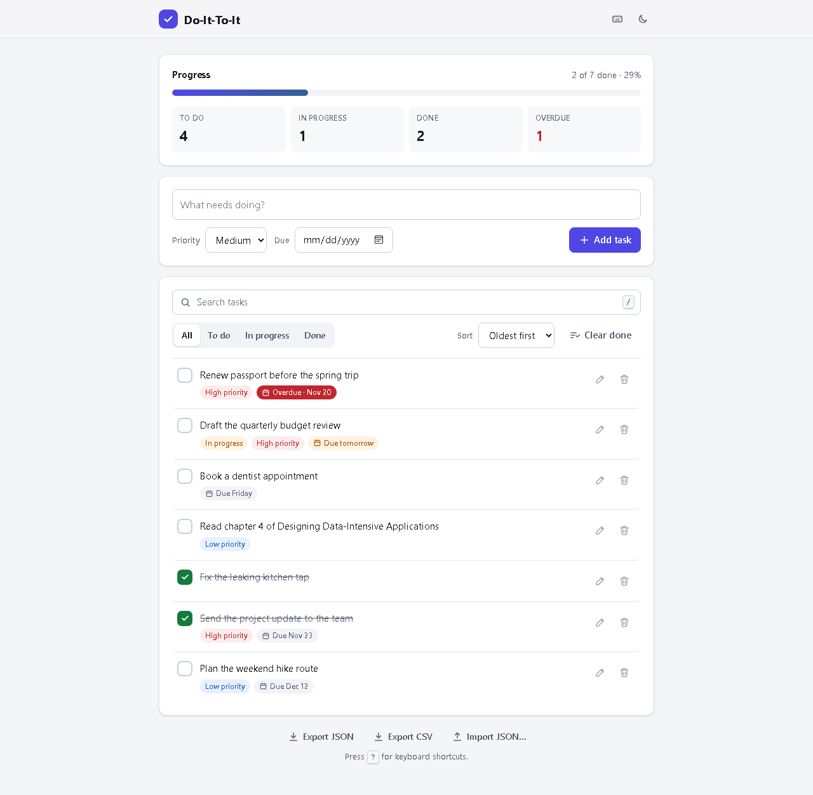
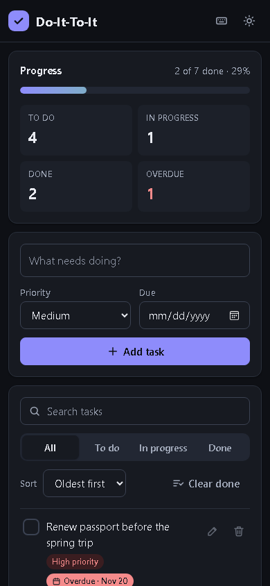

# Do-It-To-It

A small task manager with two front ends over one database: a keyboard-friendly **web app** and an
interactive **terminal console**. Built with Java 21 and Spring Boot 3.5. Tasks are stored in a
local H2 database, and both front ends can run at the same time.


<p align="center">
  
  
</p>

## Contents

- [Features](#features)
- [Getting started](#getting-started)
- [Using the web app](#using-the-web-app)
- [Using the console](#using-the-console)
- [REST API](#rest-api)
- [Configuration](#configuration)
- [Architecture](#architecture)
- [Development](#development)
- [Troubleshooting](#troubleshooting)
- [License](#license)

## Features

- Tasks have a description, a status (to do, in progress, done), a priority (low, medium, high) and an
  optional due date. Unfinished tasks past their due date are flagged as overdue.
- **Web app**: add, edit inline, complete and delete tasks; filter by status, search, sort, and clear
  finished tasks. It also has a progress summary, keyboard shortcuts, light and dark themes, and a
  layout that works at phone widths.
- **Console**: a menu-driven terminal interface with an aligned task table, search, editing and
  clear-completed.
- **REST API** under `/api/todos`, with an OpenAPI description and Swagger UI. Errors are returned as
  [RFC 9457](https://www.rfc-editor.org/rfc/rfc9457) problem details. ETags and `If-Match` prevent
  lost updates.
- **Shared storage**: an H2 file database in your home directory, with its schema versioned by
  Flyway. The console and the web app can be open at once, and a change made in one never silently
  overwrites a change made in the other.

## Getting started

### Prerequisites

- A JDK, version 21 or newer, on the `PATH` or set as `JAVA_HOME`. [Eclipse Temurin](https://adoptium.net/) is a good choice.
- Nothing else: the Maven wrapper downloads Maven the first time it runs.

### Build

```bash
git clone https://github.com/hillmatthew2000/Do-It-To-It.git
cd Do-It-To-It/do-it-to-it
./mvnw package          # Windows: mvnw.cmd package
```

This runs the tests and produces `target/do-it-to-it-0.0.1-SNAPSHOT.jar`.
Add `-DskipTests` for a quicker build.

### Run

| What                     | Windows                     | Any platform                                                |
| ------------------------ | --------------------------- | ----------------------------------------------------------- |
| Web app (port 8080)      | `run.bat`                   | `java -jar target/do-it-to-it-0.0.1-SNAPSHOT.jar --spring`  |
| Console                  | `console.bat`               | `java -jar target/do-it-to-it-0.0.1-SNAPSHOT.jar`           |
| Web app from source      |                             | `./mvnw spring-boot:run`                                    |

The `.bat` launchers live in `do-it-to-it/` and work from any directory. They can also be started by
double-clicking. They use `JAVA_HOME` if it is set, or else the `java` on the `PATH`, and they pass
any extra arguments to the app (for example `run.bat --server.port=9090`). `--web` is accepted
as an alias for `--spring`.

When the web app is ready it logs its address and the folder where tasks are kept:

```text
Do-It-To-It is ready at http://localhost:8080/ (API docs: http://localhost:8080/swagger-ui.html)
Tasks are stored in C:\Users\you\.do-it-to-it
```

## Using the web app

Open <http://localhost:8080>. Type a task and press Enter to add it, and optionally pick a priority
and due date first. Tick the checkbox to complete a task. Click the pencil or double-click the text
to edit a task, and use the bin to delete it. The filter, sort order and theme are remembered per
browser.

You can do everything from the keyboard. Press <kbd>?</kbd> in the app for this list:

| Key                         | Action                                   |
| --------------------------- | ---------------------------------------- |
| <kbd>N</kbd>                | Focus the new-task field                 |
| <kbd>/</kbd>                | Search                                   |
| <kbd>J</kbd> / <kbd>K</kbd> (or arrows) | Next / previous task         |
| <kbd>X</kbd> or <kbd>Space</kbd> | Toggle done                         |
| <kbd>E</kbd> or <kbd>Enter</kbd> | Edit the focused task               |
| <kbd>Del</kbd>              | Delete the focused task                  |
| <kbd>1</kbd>–<kbd>4</kbd>   | Show all / to do / in progress / done    |
| <kbd>T</kbd>                | Toggle light and dark theme              |
| <kbd>Esc</kbd>              | Cancel an edit or clear the search       |

## Using the console

Run `console.bat` or `java -jar target/do-it-to-it-0.0.1-SNAPSHOT.jar`, then pick an option by
number. Words such as `list`, `add` or `quit` also work.

```text
Do-It-To-It
===========
7 tasks: 4 pending, 1 in progress, 2 completed (1 overdue).

What would you like to do?
  1  List tasks
  2  Add a task
  3  Edit a task
  4  Mark a task completed
  5  Delete a task
  6  Search tasks
  7  Clear completed tasks
  0  Exit
> 1

ID  Status       Priority  Due                   Description
--  -----------  --------  --------------------  --------------------------------------------------
 1  Pending      High      2026-11-20 (overdue)  Renew passport before the spring trip
 2  In progress  High      2026-11-25            Draft the quarterly budget review
 3  Pending      Medium    2026-11-27            Book a dentist appointment
 4  Pending      Low       -                     Read chapter 4 of Designing Data-Intensive Appl...
 5  Completed    Medium    -                     Fix the leaking kitchen tap
```

When adding or editing, due dates accept `yyyy-mm-dd`, `today` or `tomorrow`. Press Enter to keep
the current value, or type `none` to clear the due date. The console keeps the terminal clean by
writing its log to `<data dir>/logs/console.log`.

## REST API

The interactive documentation is at <http://localhost:8080/swagger-ui.html>, and the OpenAPI
document is at `/v3/api-docs`.

| Method   | Path                        | Description                                                        | Success |
| -------- | --------------------------- | ------------------------------------------------------------------ | ------- |
| `GET`    | `/api/todos`                | List tasks. Optional `status`, `q` (text search) and `sort`         | `200`   |
| `GET`    | `/api/todos/{id}`           | Get one task                                                       | `200`   |
| `POST`   | `/api/todos`                | Create a task                                                      | `201` with `Location` |
| `PUT`    | `/api/todos/{id}`           | Replace a task. Omitted optional fields reset to their defaults    | `200`   |
| `PATCH`  | `/api/todos/{id}`           | Change only the fields that are sent                               | `200`   |
| `PATCH`  | `/api/todos/{id}/complete`  | Mark a task completed (idempotent)                                 | `200`   |
| `DELETE` | `/api/todos/{id}`           | Delete a task                                                      | `204`   |
| `DELETE` | `/api/todos/completed`      | Delete every completed task and return `{"deleted": n}`            | `200`   |
| `GET`    | `/api/todos/stats`          | Counts: total, pending, in progress, completed, overdue            | `200`   |

`status` is one of `PENDING`, `IN_PROGRESS` or `COMPLETED`. `sort` is one of `OLDEST` (the
default), `NEWEST`, `PRIORITY`, `DUE_DATE` or `DESCRIPTION`. Both are case-insensitive.

```bash
curl -i -X POST http://localhost:8080/api/todos \
     -H "Content-Type: application/json" \
     -d '{"description": "Book a dentist appointment", "priority": "HIGH", "dueDate": "2026-12-01"}'
```

```json
{
  "id": 3,
  "description": "Book a dentist appointment",
  "status": "PENDING",
  "priority": "HIGH",
  "dueDate": "2026-12-01",
  "overdue": false,
  "createdAt": "2026-11-24T19:40:58.229927Z",
  "updatedAt": "2026-11-24T19:40:58.229927Z",
  "version": 0
}
```

The `description` field is required. It is trimmed and may be 1–500 characters long. `status`
defaults to `PENDING`, `priority` (`LOW`, `MEDIUM` or `HIGH`) defaults to `MEDIUM`, and `dueDate`
(`yyyy-MM-dd`) is optional.

### Avoiding lost updates

Every change to a task increments its `version`. Single-task responses also send the version as an
`ETag` header, for example `ETag: "0"`. If you send that value back in `If-Match` on `PUT`, `PATCH`
or `DELETE`, the change is only made while the task is still at that version. If someone changed it
in the meantime, the response is `412 Precondition Failed` and nothing is overwritten:

```bash
curl -i -X PATCH http://localhost:8080/api/todos/3 -H 'If-Match: "0"'      -H "Content-Type: application/json" -d '{"status": "COMPLETED"}'
```

Requests without `If-Match` are applied unconditionally, as before. The web app and the console
both use these checks. If you edit a task in one while it is changed in the other, you are told
about the conflict and shown the latest version instead of silently overwriting it.

### Errors

Errors are `application/problem+json`. Validation failures also map each invalid field to its
message:

```json
{
  "type": "about:blank",
  "title": "Invalid request",
  "status": 400,
  "detail": "Description is required",
  "instance": "/api/todos",
  "errors": { "description": "Description is required" }
}
```

For monitoring, `/actuator/health` reports the app and database status, and `/actuator/info` shows
the build version and Java runtime.

## Configuration

Pass any of these as `--name=value` arguments, which also work with the launchers, or set them as
environment variables (for example `TODO_DATA_DIR`).

| Property                   | Default            | Purpose                                                    |
| -------------------------- | ------------------ | ---------------------------------------------------------- |
| `todo.data-dir`            | `~/.do-it-to-it`   | Folder for the database (`tasks.mv.db`) and console log     |
| `server.port`              | `8080`             | Web server port                                            |
| `todo.cors.allowed-origins`| *(empty)*          | Comma-separated origins allowed to call `/api/**` from a browser. The bundled UI does not need it |
| `logging.file.name`        | *(none in web mode)* | Also write the log to this file                          |

The database is opened with H2's `AUTO_SERVER` mode. That is what lets the console and the web
app share it, but it also means you should not point two different machines at the same folder on a
network share.

## Architecture

```text
do-it-to-it/src/main/java/io/github/hillmatthew2000/do_it_to_it/
├── DoItToItApplication.java   Entry point: console by default, web app with --spring
├── LaunchMode.java            Parses the mode flags and passes everything else to Spring
├── task/                      Domain and use cases, shared by both front ends
│   ├── Task.java              JPA entity
│   ├── TaskDetails.java       Validated, normalized editable fields
│   ├── TaskChanges.java       Partial update (PATCH)
│   ├── TaskService.java       Transactional use cases: list, create, update, complete, delete, stats
│   └── TaskRepository.java    Spring Data JPA queries
├── web/                       REST controller, request/response records, error handling,
│                              OpenAPI metadata and security headers
└── console/                   TodoConsole (menu loop) and TaskTable (text rendering)

do-it-to-it/src/main/resources/
├── static/                    The web app: index.html, css/app.css, js/app.js (no build step)
├── db/migration/              Flyway migrations
└── application*.properties    Defaults; application-console.properties applies to console mode
```

Both front ends call `TaskService`, so the rules for validation, defaults and overdue dates live in
one place. The web UI is plain HTML, CSS and JavaScript served by Spring Boot and talks only to the
REST API. Because it uses no inline scripts or styles, every response can carry a strict
`Content-Security-Policy`.

## Development

```bash
cd do-it-to-it
./mvnw verify                  # compile with -Xlint:all -Werror, run the tests, check formatting, write coverage
./mvnw spotless:apply          # format Java sources (Palantir Java Format)
./mvnw spring-boot:run         # run the web app from source (DevTools restarts it on recompile)
```

- The tests use JUnit 5, Spring's MockMvc and full-stack integration tests against an in-memory
  H2 database. Your real data is never touched. The coverage report is written to
  `target/site/jacoco/index.html`.
- To change the schema, add a new migration in `src/main/resources/db/migration` (for example
  `V2__add_column.sql`). Do not edit a migration that has already shipped, because Hibernate
  validates the entities against the migrated schema at startup.
- GitHub Actions runs `./mvnw verify` on every push to `main` and on every pull request.

## Troubleshooting

- **"Java 21 or newer is required"** from a launcher: install a JDK 21+, then set `JAVA_HOME` or
  add its `bin` folder to the `PATH`, and open a new terminal.
- **"No application jar found"**: build it first with `mvnw.cmd package` in `do-it-to-it/`.
- **Port 8080 is in use**: start on another port with `run.bat --server.port=9090` or
  `java -jar … --spring --server.port=9090`.
- **`./mvnw: Permission denied`** on macOS or Linux: run `chmod +x mvnw`.
- **Something went wrong in the console**: details are in `~/.do-it-to-it/logs/console.log`.

## License

[MIT](LICENSE)
